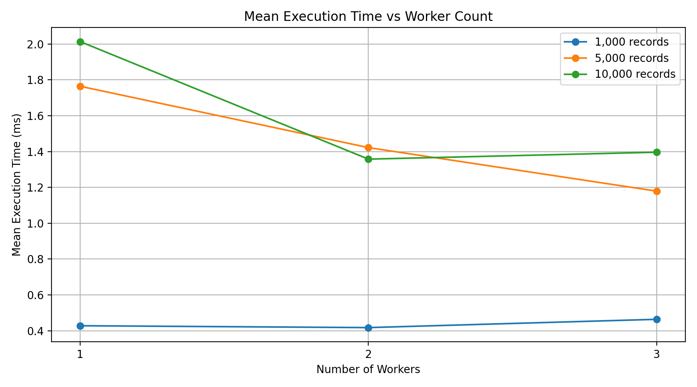
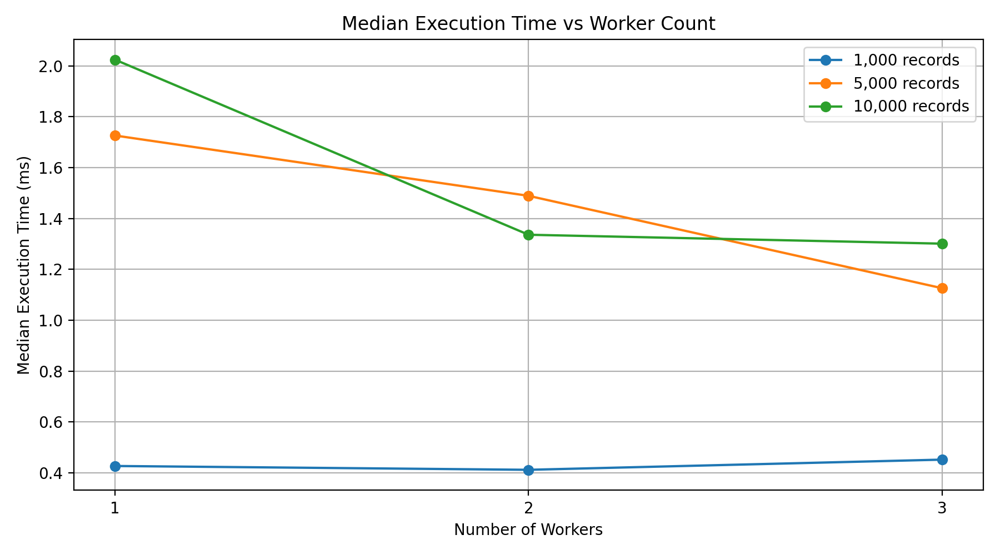
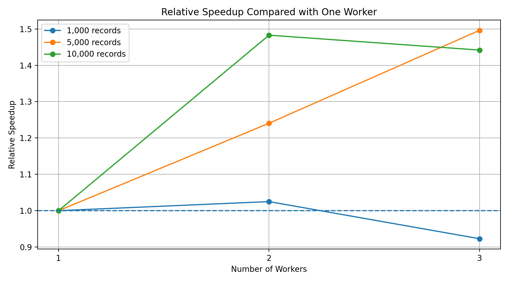

# SecureIPC - Benchmark Analysis Report

## 1. Experiment Overview

- Dataset sizes: 1,000, 5,000 and 10,000 records.
- Worker configurations: 1, 2 and 3 workers.
- Trials per configuration: 5.
- Total benchmark runs: 45.
- Metric: Internal analysis execution time in milliseconds.

## 2. Benchmark Results

| Records | Workers | Mean (ms) | Median (ms) | Min (ms) | Max (ms) |
|---:|---:|---:|---:|---:|---:|
| 1,000 | 1 | 0.4278 | 0.427 | 0.402 | 0.468 |
| 1,000 | 2 | 0.4174 | 0.412 | 0.399 | 0.446 |
| 1,000 | 3 | 0.4636 | 0.452 | 0.430 | 0.507 |
| 5,000 | 1 | 1.7644 | 1.726 | 1.201 | 2.459 |
| 5,000 | 2 | 1.4222 | 1.489 | 1.125 | 1.635 |
| 5,000 | 3 | 1.1792 | 1.126 | 0.811 | 1.649 |
| 10,000 | 1 | 2.0136 | 2.024 | 1.974 | 2.035 |
| 10,000 | 2 | 1.3578 | 1.336 | 1.285 | 1.489 |
| 10,000 | 3 | 1.3964 | 1.301 | 1.172 | 1.969 |

## 3. Graphs

### Mean Execution Time

### Median Execution Time

### Relative Speedup

## 4. Observations

- For 1,000 records, 2 worker(s) had the lowest observed mean execution time (0.4174 ms).
- For 5,000 records, 3 worker(s) had the lowest observed mean execution time (1.1792 ms).
- For 10,000 records, 2 worker(s) had the lowest observed mean execution time (1.3578 ms).

The results suggest that worker count affects execution time, but the effect depends on dataset size. More workers do not necessarily improve performance in every configuration.

## 5. Conclusion

The experiment demonstrates how different worker configurations affect SecureIPC dataset-processing performance. For the larger datasets tested, multiple workers generally performed better than a single worker. However, the best configuration varied by dataset.

## 6. Measurement Limitations

- Execution time measures the internal dataset-analysis operation.
- Socket request setup and Flask dashboard overhead are excluded.
- Process creation, synchronization and operating-system scheduling can affect measured results.
- The measurements are very small, so caching and timing variation may influence the results.
- Results are specific to this machine and test environment.

## 7. Reproducibility

Raw measurements: `benchmark_results.csv`

Summary measurements: `benchmark_summary.csv`

Individual run logs: `benchmark_logs/`
